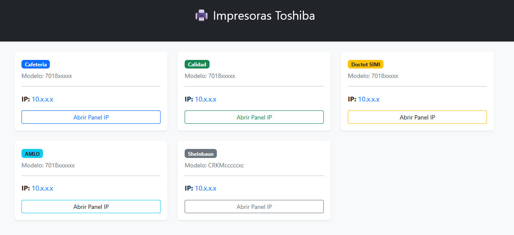
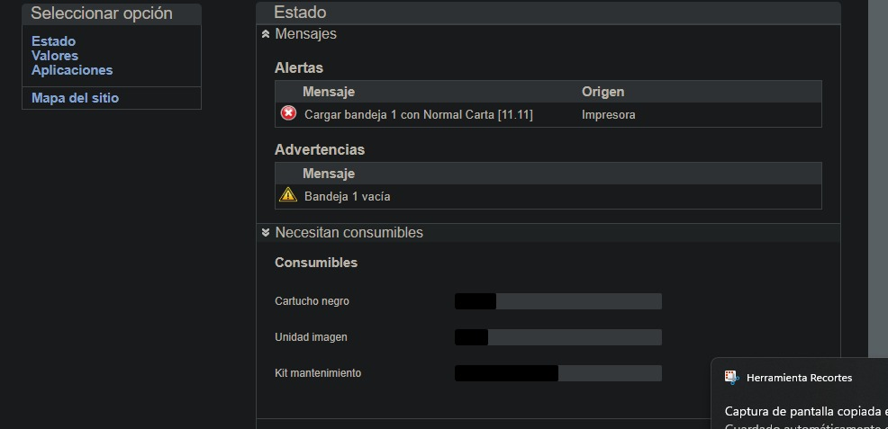

# Monitoreo de impresoras Toshiba

Este proyecto es una herramienta sencilla para concentrar en un solo lugar la informacion de las impresoras Toshiba de la organizacion. Su objetivo principal es facilitar el acceso a cada impresora y servir como base para consultar su estado y sus consumibles desde Python.

El archivo `index.html` presenta todas las impresoras a la vista mediante tarjetas organizadas por area. Cada tarjeta muestra el area, el modelo, la direccion IP y un boton para abrir directamente el panel web de la impresora.


La interfaz web de estas impresoras es la misma que se muestra en la imagen `interfaz.jpg`.

En base a ella se obtiene el estado de la impresora en formato JSON, que luego es procesado por los scripts `estado.py` y `tintas.py` para extraer los niveles de consumibles.


## Vista de la interfaz



## Funcionalidades

- Visualizar varias impresoras en una sola pagina.
- Identificar rapidamente el area a la que pertenece cada impresora.
- Consultar el modelo y la direccion IP registrada.
- Abrir el panel web de una impresora con un solo clic.
- Consultar mediante Python el estado JSON de una impresora.
- Extraer los niveles de consumibles, como el toner negro, la unidad de imagen y el kit de mantenimiento.
- Detectar niveles bajos de consumibles para preparar futuras notificaciones.

## Estructura del proyecto

| Archivo | Descripcion |
| --- | --- |
| `index.html` | Panel visual con todas las impresoras y accesos a sus direcciones IP. |
| `estado.py` | Realiza peticiones HTTP y obtiene el estado de una impresora en formato JSON. |
| `extraer.py` | Descarga y analiza el HTML de una pagina de impresora usando BeautifulSoup. |
| `tintas.py` | Extrae los niveles de consumibles a partir de la respuesta de estado. |
| `aviso.py` | Comprueba si algun consumible esta por debajo del nivel minimo definido. |
| `interfaz.jpg` | Imagen de referencia utilizada para documentar la interfaz. |
| `requirements.txt` | Dependencias necesarias para ejecutar los scripts Python. |

## Requisitos

- Python 3.
- Acceso a la red donde se encuentran las impresoras.
- Navegador web para abrir `index.html`.

## Instalacion

1. Crear y activar un entorno virtual de Python, si se desea trabajar de forma aislada.
2. Instalar las dependencias:

	```bash
	pip install -r requirements.txt
	```

3. Sustituir las direcciones de ejemplo (`10.x.x.x`) por las IP reales de las impresoras en `index.html` y `tintas.py`.

## Uso

### Panel de impresoras

Abrir `index.html` en un navegador. Desde ahi se puede consultar el listado completo y entrar al panel web de cada impresora.

### Consulta de consumibles

El script `tintas.py` construye la URL de estado de una impresora y utiliza el endpoint:

```text
/webglue/rawcontent?timedRefresh=1&c=Status&lang=es
```

Despues, `estado.py` obtiene la respuesta JSON y `tintas.py` busca los valores actuales de los consumibles. `aviso.py` comprueba si alguno esta en un nivel igual o inferior a 10.

## Notas

- Las IP incluidas en el proyecto son valores de ejemplo y deben reemplazarse por las direcciones reales.
- Las impresoras deben estar accesibles desde la misma red para que las consultas funcionen.
- La funcion de notificaciones por Telegram esta preparada como base, pero requiere configurar el token del bot y el identificador del chat antes de utilizarla.
- No se deben publicar en un repositorio los tokens, credenciales ni direcciones internas reales.
